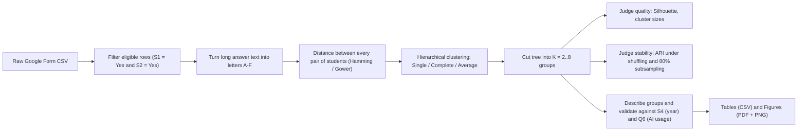

# CODE_EXPLAINED.md
### A line-by-line guide to `code/analysis.py` and `code/analysis.R`

> Project: **"When AI Disagrees With You"**: hierarchical cluster analysis of how university students react when an AI gives them uncertain or conflicting answers.

---

## 0. The big picture (read this first)

Both scripts answer one question:

> *Can we group students into "types" based on how they answered 5 scenario questions (Q1–Q5)?*

Both scripts follow the same pipeline:



| | `analysis.R` | `analysis.py` |
|---|---|---|
| Role | **Main analysis.** Builds every table and figure. | **Independent check.** Re-implements the core maths by hand with no libraries (pure Python) to confirm R's numbers. |
| Libraries | `cluster` (for `daisy`, `silhouette`) plus base R | Only the Python standard library (`csv`, `statistics`, `collections`, …) |
| Output | `output/tables/*.csv`, `output/figures/*.pdf/.png` | Text printed to the terminal |
| Order to run | Run **first** | Run **second**. It reads `cleaned_responses.csv`, which R creates |

### Dataset columns (11 columns in the CSV)

| Index (Python, 0-based) | R name | Meaning |
|---|---|---|
| 0 | `Timestamp` | When the form was submitted |
| 1 | `S1_Enrolled` | "Are you a university student?" (must be Yes) |
| 2 | `S2_Consent` | "Do you consent?" (must be Yes) |
| 3 | `S3_Major` | Field of study |
| 4 | `S4_Year` | Year of study |
| 5–9 | `Q1_Raw` … `Q5_Raw` | The 5 scenario answers (long text) |
| 10 | `Q6_Days` | Days of AI use in the past 7 days (0–7) |

### The 5 scenarios and option codes

| Q | Scenario | # options |
|---|---|---|
| Q1 | AI disagrees with *your* answer | 6 (A–F) |
| Q2 | Two AIs disagree with each other | 6 (A–F) |
| Q3 | AI cites a paper you can't find | 5 (A–E) |
| Q4 | AI solution has an unclear step | 5 (A–E) |
| Q5 | AI flips its own answer | 6 (A–F) |

General meaning of the letters: **A** = check course material, **B** = solve it yourself, **C** = ask the *same* AI, **D** = ask a *different* AI (or a classmate in Q4), **E/F** = accept or ignore without checking.

Number of possible answer combinations: 6 × 6 × 5 × 5 × 6 = **5400** (this is the "/ 5400 possible" printed by Python).

---

## 1. Key concepts you need

### 1.1 Normalized Hamming distance (= Gower distance for categorical data)
For two students *i* and *j* with answers \(x_i = (x_{i1},…,x_{i5})\):

$$
d(i,j) = \frac{1}{p}\sum_{k=1}^{p} \mathbf{1}[x_{ik} \neq x_{jk}], \qquad p = 5
$$

i.e. **the fraction of questions on which they answered differently**. Since p = 5, d can only be 0, 0.2, 0.4, 0.6, 0.8 or 1.0.
*Example:* `A-B-C-A-B` vs `A-B-D-A-E` differ on Q3 and Q5, so d = 2/5 = **0.4**.

With only 6 possible values there are **lots of ties** (many pairs at exactly the same distance). That is why the code includes a tie / row-order sensitivity check.

### 1.2 Agglomerative hierarchical clustering
1. Start: every student is their own cluster (n clusters).
2. Find the two **closest** clusters and merge them.
3. Update distances from the new cluster to every other cluster.
4. Repeat until one cluster remains. The record of merges is the **dendrogram** (a tree).
5. "Cutting" the tree at K clusters gives a partition.

How to measure the distance between two *clusters* is the **linkage**:

| Linkage | d(A∪B, C) | Behaviour |
|---|---|---|
| Single | min(d(A,C), d(B,C)) (nearest neighbour) | "Chaining": one giant cluster plus singletons |
| Complete | max(d(A,C), d(B,C)) (farthest neighbour) | Compact clusters, very sensitive to ties |
| Average (UPGMA) | (\|A\|·d(A,C) + \|B\|·d(B,C)) / (\|A\|+\|B\|) | Compromise; the method chosen here |

These update rules are the **Lance–Williams recurrence**.

### 1.3 Silhouette width (quality of one partition)
For student *i*:
- a(i) = average distance to the other members of **its own** cluster
- b(i) = smallest average distance to the members of **another** cluster (the "next best" cluster)

$$
s(i) = \frac{b(i) - a(i)}{\max(a(i), b(i))} \in [-1, 1]
$$

s ≈ 1 means well placed, s ≈ 0 means on the border, s < 0 means probably in the wrong cluster. The script reports the **average** s and **how many** students have s < 0. By convention a student alone in a cluster (singleton) gets s = 0.

### 1.4 Adjusted Rand Index (ARI): agreement between two partitions
Build the contingency table \(n_{ij}\) = number of students in cluster *i* of partition X **and** cluster *j* of partition Y. With row sums \(a_i\) and column sums \(b_j\):

$$
\text{ARI} = \frac{\sum_{ij}\binom{n_{ij}}{2} - \dfrac{\sum_i\binom{a_i}{2}\sum_j\binom{b_j}{2}}{\binom{n}{2}}}
{\tfrac12\left[\sum_i\binom{a_i}{2}+\sum_j\binom{b_j}{2}\right] - \dfrac{\sum_i\binom{a_i}{2}\sum_j\binom{b_j}{2}}{\binom{n}{2}}}
$$

That is (observed − expected) / (maximum − expected). ARI = 1 means identical partitions, ARI ≈ 0 means no better than random. It **ignores label names**: cluster "1" in X can match cluster "3" in Y.

### 1.5 Cophenetic correlation
The cophenetic distance between two students is the height at which they first join in the dendrogram. Its correlation with the original distances tells you how faithfully the tree represents the data (closer to 1 is better).

---

# PART A: `analysis.R` (main analysis)

## A.1 Setup (lines 1–29)

```r
#!/usr/bin/env Rscript
```
"Shebang": lets you run `./analysis.R` directly on Linux. Normally you just run `Rscript analysis.R`.

```r
options(stringsAsFactors = FALSE, width = 120)
```
- `stringsAsFactors = FALSE`: when reading text, keep it as plain strings and don't automatically convert it to factors (R ≥ 4 does this by default anyway).
- `width = 120`: console printing width.

```r
library(cluster); library(stats); library(graphics); library(grDevices)
```
- `cluster` provides `daisy()` (distance) and `silhouette()`.
- `stats` provides `hclust`, `cutree`, `cophenetic`, `cor`, `aggregate`.
- `graphics` and `grDevices` provide plotting, `pdf()` and `png()`. The last three load automatically; listing them just documents the dependencies.

```r
set.seed(20261111)
```
Fixes the random number generator so the random shuffles and subsamples come out **identical every run** (reproducibility). The seed is simply a date.

```r
base_dir <- "/mnt/hdd-1tb/CSE-VGU/2026-2027/Elective-1"
csv_path <- file.path(base_dir, "When AI Disagrees ... .csv")
out_dir  <- file.path(base_dir, "output")
fig_dir  <- file.path(out_dir, "figures")
tab_dir  <- file.path(out_dir, "tables")
dir.create(fig_dir, recursive = TRUE, showWarnings = FALSE)
dir.create(tab_dir, recursive = TRUE, showWarnings = FALSE)
```
- `<-` is R's assignment operator (like `=`).
- `file.path()` joins folder names with `/`.
- `dir.create(..., recursive = TRUE)` creates the folder and any missing parent folders. `showWarnings = FALSE` keeps it quiet if the folder already exists.
- ⚠️ The path is **absolute**. On another computer you must edit `base_dir`.

## A.2 Helper: `adjusted_rand_index(x, y)` (lines 34–47)

```r
tab <- table(x, y)              # contingency table n_ij
n <- sum(tab)                   # total number of students
if (n <= 1) return(1.0)         # trivial case
sum_nij2 <- sum(choose(tab, 2)) # Σ C(n_ij, 2): pairs together in BOTH partitions
sum_ai2  <- sum(choose(rowSums(tab), 2))  # Σ C(a_i, 2): pairs together in X
sum_bj2  <- sum(choose(colSums(tab), 2))  # Σ C(b_j, 2): pairs together in Y
total_pairs <- choose(n, 2)               # C(n, 2): all pairs
expected_index <- (sum_ai2 * sum_bj2) / total_pairs   # expected value under random labelling
max_index <- 0.5 * (sum_ai2 + sum_bj2)                # maximum possible value
denom <- max_index - expected_index
if (abs(denom) < 1e-12) return(1.0)       # avoid dividing by 0 (e.g. both partitions = 1 cluster)
(sum_nij2 - expected_index) / denom       # the last expression is the return value
```
- `choose(k, 2)` = k(k−1)/2 = the number of pairs among k items. Applied to a whole table it works element-wise.
- In R, a function returns the value of its **last expression** automatically.
- This is exactly the formula in §1.4. It is written by hand so the results don't depend on an extra package (e.g. `mclust::adjustedRandIndex`).

## A.3 Helper: `save_dual_plot(filename_stem, width_in, height_in, plot_fn)` (lines 50–59)

```r
pdf(pdf_file, width = width_in, height = height_in, useDingbats = FALSE)
plot_fn()
dev.off()
png(png_file, width = width_in * 150, height = height_in * 150, res = 150)
plot_fn()
dev.off()
```
- Takes a **function** `plot_fn` containing the drawing code and runs it twice: once into a PDF (vector graphics for the LaTeX report) and once into a PNG (for slides).
- `pdf()` / `png()` open a "graphics device" (a file to draw into). `dev.off()` closes it and writes the file.
- `useDingbats = FALSE` stops the PDF from using a special font for point symbols, which can display wrongly in some viewers.
- PNG size is given in pixels: inches × 150, at 150 dpi resolution.
- `paste0("fig01", ".pdf")` joins strings with no separator.

## A.4 Load and clean data (lines 64–141)

```r
raw_df <- read.csv(csv_path, check.names = FALSE, encoding = "UTF-8")
colnames(raw_df) <- c("Timestamp", "S1_Enrolled", ..., "Q6_Days")
```
- Reads the CSV into a **data frame** (a table). `check.names = FALSE` keeps the original long question headers as they are, and the next line replaces them with short names anyway.

```r
df <- raw_df[trimws(raw_df$S1_Enrolled) == "Yes" & trimws(raw_df$S2_Consent) == "Yes", ]
```
- `trimws()` removes leading and trailing spaces.
- `df[rows, cols]`: the condition chooses rows, and the empty spot after the comma means "all columns".
- `&` is element-wise AND. Only students who are enrolled **and** consented are kept (this gives n = 263).

```r
df$ID <- sprintf("R%03d", seq_len(nrow(df)))
```
- `seq_len(263)` = 1, 2, …, 263. `sprintf("R%03d", 7)` = `"R007"` (3 digits, zero-padded). Each student gets an ID.

### Mapping functions `map_q1` … `map_q5`
```r
ifelse(x == "Check the relevant course material.", "A",
ifelse(x == "...", "B", ... NA_character_))
```
- `ifelse(cond, yes, no)` is **vectorised**: it handles the whole column at once. Nesting them gives an "if / else if / … / else" chain.
- If no text matches, the result is `NA_character_` (missing, text type).
- Two texts map to "D" in Q1 (`%in% c(...)`) because the form wording was changed while the survey was running.
- Q3 uses `grepl("^Ask the same AI for the paper", x)`. This is a regex match on the **beginning** (`^`) of the text, because some answers contain a curly apostrophe `’` and others a straight one `'`.

```r
df$Q1 <- factor(map_q1(df$Q1_Raw), levels = c("A","B","C","D","E","F"))
```
- A **factor** is R's type for categorical variables. Fixing `levels` makes sure every option exists (even with 0 counts) and keeps them in A→F order.

```r
stopifnot(all(colSums(is.na(df[, c("Q1",...,"Q5")])) == 0))
```
- Safety check: stops the script with an error if **any** answer failed to map (NA). `is.na` gives TRUE/FALSE, `colSums` counts the TRUEs per column, and `all(... == 0)` requires zero everywhere.

```r
df$S3_Clean <- ifelse(trimws(df$S3_Major) == "" | ... == "Prefer not to answer", "Unspecified", trimws(df$S3_Major))
df$S4_Clean <- ... (same) ...
df$S4_Clean <- factor(df$S4_Clean, levels = c("1st year", ..., "Unspecified"))
```
- Blank or "Prefer not to answer" becomes `"Unspecified"`. `|` is element-wise OR.
- Year becomes an ordered set of levels so tables come out in 1st→4th→Grad order.

```r
df$Q6_Num  <- as.integer(trimws(df$Q6_Days))
df$Profile <- paste(df$Q1, df$Q2, df$Q3, df$Q4, df$Q5, sep = "-")
```
- Q6 converted to a number (0–7).
- `Profile` is a readable string like `"A-B-C-A-B"`.

## A.5 Marginal distributions (lines 146–159)

```r
for (q in q_cols) {
  tb  <- table(df[[q]])                     # counts per option
  pct <- round(100 * prop.table(tb), 1)     # percentages, 1 decimal
  marginal_list[[q]] <- data.frame(Question = q, Option = names(tb),
                                   Count = as.integer(tb), Percentage = as.numeric(pct))
}
marginal_df <- do.call(rbind, marginal_list)
write.csv(marginal_df, file.path(tab_dir, "marginal_q1_q5.csv"), row.names = FALSE)
```
- `df[[q]]` gets a column by a name stored in a variable (`df$q` would look for a column literally called "q").
- `prop.table` divides by the total, giving proportions.
- Collect small data frames in a list, then `do.call(rbind, list)` stacks them into one table. This is the standard R pattern used throughout the script.
- `row.names = FALSE` stops R from writing an extra index column.

## A.6 Distance matrix and the three trees (lines 161–173)

```r
df_q <- df[, q_cols]          # only the 5 factor columns
rownames(df_q) <- df$ID       # rows labelled R001..R263 (used later for matching)
dist_hamming <- daisy(df_q, metric = "gower")
dist_vec <- as.numeric(dist_hamming)
```
- `daisy()` with Gower on **factor** columns gives, per variable, 0 if equal and 1 if different, then averages over the 5 variables. That is exactly the normalized Hamming distance (§1.1).
- The result is a `dist` object (lower triangle only). `as.numeric` flattens it into a vector of the 263·262/2 = **34,453** pairwise distances.

```r
hc_single   <- hclust(dist_hamming, method = "single")
hc_complete <- hclust(dist_hamming, method = "complete")
hc_average  <- hclust(dist_hamming, method = "average")
```
Builds the three dendrograms (§1.2). `"average"` = UPGMA.

```r
coph_average <- cor(dist_hamming, cophenetic(hc_average))
```
Cophenetic correlation (§1.5) for each method. These values are shown in Figure 3's titles.

## A.7 Evaluate K = 2..8 for each linkage (lines 178–202)

```r
for (m_name in c("Single", "Complete", "Average")) {
  hc_obj <- switch(m_name, Single = hc_single, Complete = hc_complete, Average = hc_average)
  for (k in k_range) {
    cl  <- cutree(hc_obj, k = k)          # vector: cluster number 1..k for each student
    sil <- silhouette(cl, dist_hamming)   # matrix with columns cluster, neighbor, sil_width
    sil_vals <- sil[, "sil_width"]
    sz <- sort(as.integer(table(cl)), decreasing = TRUE)   # cluster sizes, largest first
    eval_rows[[length(eval_rows) + 1]] <- data.frame(...)
```
- `switch()` picks a value by name (like a dictionary lookup).
- `cutree(tree, k)` cuts the dendrogram so there are exactly k groups.
- `eval_rows[[length(eval_rows) + 1]] <- ...` is how you **append** to a list in R.

Columns written to `linkage_k_evaluation.csv`:

| Column | Meaning |
|---|---|
| `Avg_Silhouette` | Mean s(i): overall quality |
| `Neg_Sil_Count` / `Neg_Sil_Pct` | Number and % of students with s < 0 (possibly misassigned). `mean(TRUE/FALSE)` = proportion of TRUEs |
| `Max_Cluster_Size` / `Max_Cluster_Pct` | Largest group. A very high value (≈ 95%+) means **chaining** |
| `Min_Cluster_Size`, `Singletons` | Smallest group and how many groups contain exactly 1 person |
| `Cluster_Sizes` | e.g. `"68/60/49/46/20/18"` |

## A.8 Stability analysis (lines 205–257)

```r
set.seed(20261111)
n_perm <- 100; n_sub <- 100
sub_size <- floor(0.80 * nrow(df_q))     # 80% of 263 = 210 students
```
The seed is reset so this section is reproducible on its own.

For each method and each K = 2..6:

**(a) Row-order permutation test (tie sensitivity)**
```r
cl_full <- cutree(hc_full, k = k); names(cl_full) <- rownames(df_q)
for (b in 1:100) {
  perm_idx <- sample(seq_len(nrow(df_q)))        # random shuffle of 1..263
  df_perm  <- df_q[perm_idx, , drop = FALSE]     # same data, different row order
  d_perm   <- daisy(df_perm, metric = "gower")
  hc_perm  <- hclust(d_perm, method = m_code)
  cl_perm  <- cutree(hc_perm, k = k)
  perm_aris[b] <- adjusted_rand_index(cl_full, cl_perm[names(cl_full)])
}
```
- **Why?** When several pairs have the *same* smallest distance (a tie), `hclust` merges the one that appears first. Shuffling the rows changes which tied pair is "first". If the final clusters change a lot, the result depends on an arbitrary choice.
- `cl_perm[names(cl_full)]` puts the shuffled labels back into the original student order by **ID name** before comparing.
- `drop = FALSE` keeps it a data frame even if only one column is left (a defensive habit).
- High mean ARI means robust to ties.

**(b) 80% subsampling (stability)**
```r
sub_idx <- sort(sample(seq_len(nrow(df_q)), size = sub_size, replace = FALSE))
df_sub  <- df_q[sub_idx, , drop = FALSE]
... recluster ...
sub_aris[b] <- adjusted_rand_index(cl_full[rownames(df_sub)], cl_sub)
```
- Randomly drop 20% of the students, recluster, and compare with the full-data clusters **on the same 208 students**.
- If removing some people barely changes the groups, the clusters are real structure and not noise.
- For Average linkage the 100 ARIs are stored in `sub_ari_store` for the boxplot in Figure 5.

Summary columns in `stability_sensitivity_ari.csv`: mean, SD and min of the permutation ARI; mean, SD, median and IQR (interquartile range = Q3 − Q1) of the subsample ARI.

> ⏱️ This is the slowest part: 3 methods × 5 K × 200 reclusterings = 3000 runs of `hclust`.

## A.9 Final clusters and archetypes (lines 262–301)

```r
df$Cluster_K5 <- cutree(hc_average, k = 5)
df$Cluster_K6 <- cutree(hc_average, k = 6)
```
The chosen model is **Average linkage, K = 6** (K = 5 kept for comparison).

```r
archetype_k6 <- c("1" = "C1: Cross-AI & Peer Triangulators", ...)
df$Archetype_K6 <- archetype_k6[as.character(df$Cluster_K6)]
```
A **named vector** used as a lookup table: cluster number → descriptive name. The names were chosen by the team **after** looking at each cluster's answer profile.

> ⚠️ `cutree` numbers clusters in the order their first member appears in the data. The labels are therefore only correct for **this exact data and row order**. If the CSV changes, check that the names still fit.

`cleaned_responses.csv` holds the per-student table (ID, demographics, Q1–Q5 codes, Q6, profile, cluster IDs, archetype). Python reads this file.

**Profile table (`k6_cluster_profiles.csv`)**: for each cluster × question, the % of members choosing each option A–F.
`Opt_F = ifelse(q %in% c("Q3","Q4"), NA, pcts["F"])`: Q3 and Q4 have no option F, so it is written as NA instead of a misleading 0.

## A.10 External validation (lines 304–317)

"External" means using variables that were **not** used to build the clusters. If the clusters differ on those variables, that suggests the clusters capture something meaningful.

```r
q6_val_k6 <- do.call(data.frame, aggregate(
  df$Q6_Num, by = list(Cluster = df$Cluster_K6, Archetype = df$Archetype_K6),
  FUN = function(x) c(n = length(x), Mean = ..., SD = ..., Median = ..., IQR = ...)))
```
- `aggregate` groups Q6 by cluster and applies `FUN` to each group.
- Because `FUN` returns several numbers, `aggregate` produces a *matrix column*. `do.call(data.frame, ...)` flattens it into normal columns (`x.n`, `x.Mean`, …).
- `order(...)` sorts the rows by cluster number.

```r
known_s4  <- df$S4_Clean != "Unspecified"
s4_ct_k6  <- table(Cluster = df$Cluster_K6[known_s4], Year = droplevels(df$S4_Clean[known_s4]))
s4_pct_k6 <- round(100 * prop.table(s4_ct_k6, margin = 1), 1)
```
- Excludes students with unknown year. `droplevels` removes the now-empty "Unspecified" level so it doesn't appear as an all-zero column.
- `margin = 1` gives **row** percentages: within each cluster, what % are 1st year, 2nd year, ….
- `as.data.frame.matrix` keeps the table in wide (cross-tab) form when written to CSV.

## A.11 Figures (lines 324–531)

Common base-R plotting vocabulary:

| Code | Meaning |
|---|---|
| `par(mar = c(b, l, t, r))` | Margins in lines of text (bottom, left, top, right) |
| `par(mfrow = c(r, c))` | Split the page into r × c panels |
| `xpd = TRUE` | Allow drawing outside the plot area (used to put the legend in the right margin) |
| `las = 1` | Axis labels horizontal |
| `cex`, `cex.main`, `cex.axis` | Text size multipliers |
| `pch` | Point symbol (15 = square, 17 = triangle, 18 = diamond, 19 = circle) |
| `lwd`, `lty` | Line width / line type (2 = dashed, 3 = dotted) |
| `type = "b"` | "both": points joined by lines |
| `abline(h = …)` | Horizontal reference line |
| `grid()` | Background grid lines |
| `bty = "n"` | No box around the legend |

**Trick used repeatedly:** draw `barplot`, then the grid lines, then **draw the same barplot again with `add = TRUE`**, so the bars sit *on top of* the grid lines.

| Figure | What it shows | Code notes |
|---|---|---|
| **fig01_marginal_responses** | Grouped bars: % choosing each option, per question | Builds a 6 × 5 matrix `mat_pct` (options × questions). `beside = TRUE` puts bars side by side instead of stacked. `bp` holds the bar x-positions, used to place the `"%.0f%%"` labels (`%%` prints a literal `%`). Legend is pushed outside with `inset = c(-0.22, 0)`. |
| **fig02_hamming_distribution** | % of the 34,453 pairs at d = 0, 0.2, …, 1 | `round(dist_vec, 1)` removes floating-point noise. Wrapping it in `factor(levels=…)` makes all 6 bars appear even when a count is 0. Labels show the % and the count. |
| **fig03_dendrograms_comparison** | 3 dendrograms side by side | `labels = FALSE` hides the 263 IDs. `hang = -1` makes all leaves end at height 0. `rect.hclust(k = 6)` draws boxes around the 6 clusters. The dashed line at 0.35 on the single-linkage tree is a visual reference cut. |
| **fig04_silhouette_comparison** | Left: avg silhouette vs K. Right: largest-cluster % vs K | Reads values back from `eval_df`. `points(6, …, cex = 2)` circles the chosen K = 6. The right panel exposes chaining (single linkage near 100%). |
| **fig05_stability_ari** | Left: boxplots of subsample ARI (Average, K = 2..6). Right: mean permutation ARI per method | `boxplot(list)` gives one box per list element. Red diamonds = means (`sapply(list, mean)`). `xaxt = "n"` hides the default x axis, and `axis(1, at = ks)` draws integer ticks only. |
| **fig06_cluster_profiles** | 2 × 3 grid: answer profile of each K = 6 cluster | Same logic as fig01 but within each cluster. Legend only in panel 1. |
| **fig07_external_validation** | Left: Q6 boxplot per cluster plus means. Right: stacked bars of study year per cluster | `Q6_Num ~ Cluster_K6` is formula syntax meaning "Q6 grouped by cluster". `tapply` computes the group means, drawn as a white diamond under a black one (an outline effect). `t(s4_ct_k6)` transposes so the years stack inside each cluster bar, and `margin = 2` gives column percentages. |

> ⚠️ **Hard-coded numbers:** some titles and labels are typed in by hand rather than computed: `n = 263`, `34,453 Pairs`, cluster sizes (`n=46, 17.5%` …), `Kruskal-Wallis p = 0.0103, ANOVA p = 0.0089`, `Chi-square = 77.04, p = 0.0001`. The statistical tests themselves are **not run in this script** (they presumably came from a separate analysis; see `STATS_EXPLAINED.md`). If the data changes, update these strings by hand. The same goes for the hard-coded `ylim` ranges.

```r
cat("\nAll figures and CSV tables successfully generated in:", out_dir, "\n")
```
Final message. `cat` prints without quotes or `[1]`.

---

# PART B: `analysis.py` (independent verification)

**Goal:** prove the R results don't depend on a "black-box" library by re-coding everything from scratch. Uses only the standard library.

## B.1 Header and imports (lines 1–34)

- The `"""docstring"""` describes the purpose.
- `csv` reads the CSV. `os` handles paths and folders. `statistics` provides mean, stdev and median. `collections.Counter` counts items. `defaultdict` is a dict that creates missing keys automatically.
- `math` and `random` are imported but **never used** (leftovers, harmless).
- `os.makedirs(TAB_DIR, exist_ok=True)` creates the output folder and doesn't complain if it already exists.

## B.2 Option maps (lines 40–83)
`Q1_MAP` … `Q5_MAP` are **dictionaries** (`text → letter`), the Python version of R's `ifelse` chains.
- Two different texts map to `"D"` in Q1 (wording changed during the survey).
- Q3 has both `paper’s` (curly apostrophe) and `paper's` (straight) as keys. This is Python's version of R's `grepl("^…")`.
- Difference from R: a text that isn't in the map raises a `KeyError` and crashes immediately, whereas R produces NA and then `stopifnot` catches it. The safety effect is the same.

## B.3 `load_and_clean_data(csv_path)` (lines 86–118)

```python
with open(csv_path, newline="", encoding="utf-8") as f:
    reader = csv.reader(f)
    _ = next(reader)          # skip the header row (stored in "_" = "unused")
    idx = 1
    for row in reader:        # each row is a list of strings
        s1, s2 = row[1].strip(), row[2].strip()
        if s1 != "Yes" or s2 != "Yes":
            continue          # skip ineligible respondents
```
- `with open(...)` closes the file automatically. `newline=""` is the setting the `csv` module expects.
- `.strip()` is the same as R's `trimws`.
- S3/S4 blank or "Prefer not to answer" become `"Unspecified"` (same as R).
- `q6 = int(...)` converts text to an integer.
- Each student becomes a dict:
  ```python
  {"ID": "R001", "S3": ..., "S4": ..., "Q": ("A","B","C","A","B"), "Q6": 5}
  ```
  `f"R{idx:03d}"` is an f-string with zero-padding to 3 digits (same as R's `sprintf("R%03d")`). `idx` only increases for **kept** rows, so the IDs match R's.
  `"Q"` is a **tuple**. Tuples are hashable, so `Counter` can count them as profiles.

## B.4 `hamming_distance(q_i, q_j)` (lines 124–127)

```python
return sum(1 for a, b in zip(q_i, q_j) if a != b) / p
```
`zip` pairs up the answers question by question, the generator counts the mismatches, and dividing by p = 5 gives §1.1 exactly.

## B.5 `compute_distance_matrix(records)` (lines 130–139)
- Creates an n × n matrix of zeros: `[[0.0] * n for _ in range(n)]`. (Writing `[[0.0]*n]*n` would be a bug, because all rows would be the *same* list object.)
- Loops only over `j > i` (the upper triangle) and copies each value to `[j][i]`, since distance is symmetric. The diagonal stays 0. This halves the work.

## B.6 `agglomerative_clustering(dist_matrix, method, target_k_list)` (lines 142–210), the core

A hand-written version of `hclust`.

**Data structures**
```python
clusters   = {c_id: [c_id] for c_id in range(n)}   # cluster id -> list of member indices
active_ids = list(range(n))                        # clusters that still exist
c_dist     = {(i, j): d for i < j}                 # distance between clusters, key = (smaller id, larger id)
next_id    = n                                     # new clusters get ids n, n+1, ...
```

**Main loop: runs while more than 1 cluster remains**

1. **Record the partition if the current count is a target K**
   ```python
   if k_curr in target_k_list:
       labels = [0] * n
       for rank_idx, cid in enumerate(active_ids, start=1):
           for member in clusters[cid]:
               labels[member] = rank_idx
       partitions[k_curr] = labels
   ```
   Before merging, if exactly K clusters exist, save each student's label (1..K). This is the same as `cutree(k)`. The label *numbers* may differ from R's, but ARI and silhouette don't care about label names.

2. **Find the closest pair**
   ```python
   if d_ab < best_d - 1e-12:
   ```
   Scans all active pairs. The `- 1e-12` tolerance means a pair must be *strictly* smaller to replace the current best, so **in a tie the first pair found wins**. This mimics hclust's tie-breaking and avoids floating-point noise (e.g. 0.6000000001 vs 0.6).

3. **Merge**: store the merge height, combine member lists, assign `new_cid`, and remove `ca` and `cb` from `active_ids`.

4. **Lance–Williams update**: for every remaining cluster `cc`:
   - single: `min(dac, dbc)`
   - complete: `max(dac, dbc)`
   - average: `(na*dac + nb*dbc)/(na+nb)`, the size-weighted mean of the two old distances. This equals the mean of all member-to-member distances between the merged cluster and `cc`.
   - The key is `(cc, new_cid)`. Because `new_cid` is always the largest id so far, the "(smaller, larger)" rule is respected automatically.
   - An unknown method name raises `ValueError`.

5. Register the new cluster and repeat.

Returns `partitions` (dict K → labels) and `merge_heights` (the n − 1 heights at which merges happened).

> Complexity is about O(n³) (n merges × O(n²) pair scan). That is fine for n = 263, too slow for large data.

## B.7 `average_silhouette(dist_matrix, labels)` (lines 213–241)
Direct implementation of §1.3:
- Group indices by label with `defaultdict(list)`.
- Singleton gives s = 0 (same convention as R's `cluster::silhouette`).
- `a_i`: mean distance to the others in its own cluster (divide by size − 1, excluding itself).
- `b_i`: minimum over other clusters of the mean distance.
- `s_i = (b_i - a_i) / max(a_i, b_i)`, guarded against 0/0.
- Returns `(average s, number of negative s)`.

## B.8 `adjusted_rand_index(labels_x, labels_y)` (lines 244–265)
Same formula as the R helper (§1.4):
- `Counter(zip(x, y))` is the contingency table (a count for each (x-label, y-label) pair).
- `Counter(labels_x)` gives row sums, `Counter(labels_y)` gives column sums.
- `comb2(k) = k*(k-1)//2` (`//` is integer division).
- Note: this function is **defined but not called** in `main()`. The stability analysis is only done in R. It is kept so the formula is available for checking.

## B.9 `main()` (lines 271–320): what gets printed

1. **Sample size**: `Loaded and cleaned n = 263 ...`
2. **Unique profiles**: `Counter(r["Q"] ...)` counts distinct 5-letter patterns out of 5400 possible. Few repeats means the data is sparse, which explains why clusters are fuzzy.
3. **Distance distribution**: rounds all 34,453 pairwise distances to 1 decimal, then prints the count and % at each of 0.0…1.0 plus the mean and SD. This should match Figure 2.
4. **For each linkage**: runs the clustering and prints
   - `Unique merge heights: x / 262`: very few unique heights means **lots of ties**.
   - For K = 2..8: average silhouette (`+.4f` = always show the sign, 4 decimals), negative-silhouette count and %, and cluster sizes sorted large to small. These should match `linkage_k_evaluation.csv` from R.
5. **Cross-check with R** (only if `output/tables/cleaned_responses.csv` exists):
   - `csv.DictReader` reads the rows as dicts keyed by column name.
   - Groups students by R's `Cluster_K6` and prints, per archetype, n, %, and the mean, SD and median of Q6. These should match `external_validation_q6_k6.csv`.
   - Format `{arch:<35s}` = left-align and pad to 35 characters, so the columns line up.

```python
if __name__ == "__main__":
    main()
```
Runs `main()` only when the file is executed directly (`python3 analysis.py`), not when it is imported as a module.

---

## C. How to run

```bash
cd /mnt/hdd-1tb/CSE-VGU/2026-2027/Elective-1/code
Rscript analysis.R          # needs: install.packages("cluster")  (usually preinstalled)
python3 analysis.py         # no extra packages needed
```

## D. Outputs cheat-sheet

| File | Produced by | Content |
|---|---|---|
| `tables/marginal_q1_q5.csv` | R | Option counts and % per question |
| `tables/linkage_k_evaluation.csv` | R | Silhouette and size diagnostics, 3 methods × K = 2..8 |
| `tables/stability_sensitivity_ari.csv` | R | Permutation and subsampling ARI, K = 2..6 |
| `tables/cleaned_responses.csv` | R | One row per student plus cluster labels (read by Python) |
| `tables/k6_cluster_profiles.csv` | R | Within-cluster option % |
| `tables/external_validation_q6_k6.csv` | R | Q6 stats per cluster |
| `tables/external_validation_s4_counts_k6.csv` / `_pct_k6.csv` | R | Year-of-study cross-tab |
| `figures/fig01…fig07 .pdf/.png` | R | Figures described in §A.11 |
| Terminal output | Python | Independent re-computation for verification |

## E. Quick glossary

- **Factor (R)**: categorical variable with fixed levels.
- **Data frame**: table where columns can have different types.
- **Dendrogram**: tree diagram of the merge history. Height = merge distance.
- **Chaining**: single linkage tends to make one big snake-like cluster.
- **UPGMA**: Unweighted Pair Group Method with Arithmetic mean, i.e. average linkage.
- **Tie**: two or more pairs at exactly the same distance, so which one merges first is arbitrary.
- **IQR**: interquartile range (75th − 25th percentile).
- **Seed**: starting value that makes random numbers reproducible.

