# Statistics in `main.pdf`, Explained for Beginners

This guide walks through every statistical idea in the report, in the same order the report uses them. Each one comes with an everyday analogy and the actual numbers from the study.

> You said you already understand **the clustering variables (p = 5), raw/normalized Hamming distance, and Gower dissimilarity**, so those get only a short recap in §1. Everything else is explained in full.

---

## 0. The big picture in one paragraph

We asked 263 students 5 multiple-choice "what would you do first?" questions (Q1–Q5). We wanted to know whether students **naturally fall into groups** of similar behaviour. We didn't label anyone ourselves. We measured how different every pair of students is, then let an algorithm build the groups. Next we checked three things: (a) whether the groups are any good, (b) whether they are stable, and (c) whether they also differ on things the algorithm never saw, namely weekly AI usage (Q6) and year of study (S4). The answer to all three was yes. The result is 6 groups ("archetypes").

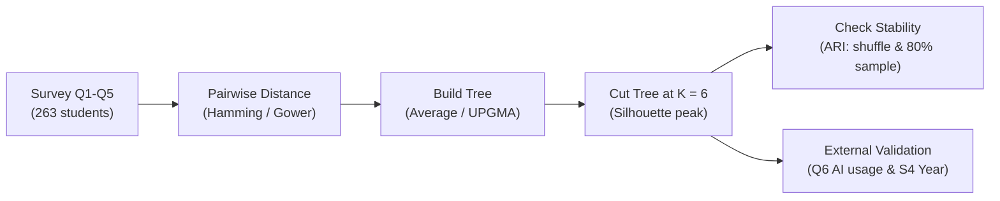

---

## 1. Quick recap (things you already know)

| Term | Meaning in our study |
|---|---|
| n = 263 | number of students (rows) |
| p = 5 | number of clustering variables (Q1–Q5) |
| Normalized Hamming / Gower distance | share of the 5 questions where two students answered differently. It can only be 0, 0.2, 0.4, 0.6, 0.8 or 1.0 |
| Distance matrix D | 263 × 263 table holding the distance between every pair of students (34,453 unique pairs) |

**Nominal variable**: answers are labels with no order (A, B, C… are not "1, 2, 3"). That's why we can't use Euclidean distance or means. "A" isn't smaller than "F".

**Discrete lattice**: a fancy way of saying "the distance can only take those 6 values". You can see those exact 6 spikes in the chart below:

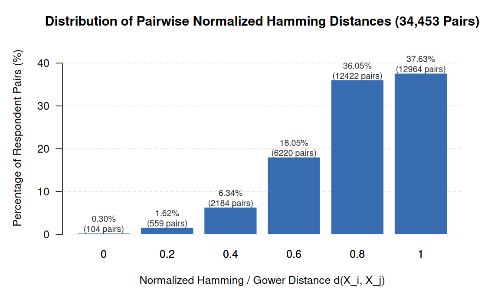

> **How to read Figure 2:** Each bar counts how many of the 34,453 student pairs fall at each distance. Only **0.30%** (104 pairs) answered all 5 questions identically (`0`), whereas **73.68%** of pairs differ on 4 or 5 questions (`0.8` or `1.0`). Because there are **no bars in between** (no `0.3` or `0.55`), those 6 values form a *discrete lattice*.

---

## 2. Basic descriptive statistics

| Term | Plain meaning | Example from report |
|---|---|---|
| **Mean** | the average | students used AI 4.10 days/week on average |
| **SD (standard deviation)**, written `±` | how spread out values are around the mean. Small SD means most people are close to the average | 4.10 **± 2.12** → most students fall roughly between 2 and 6 days |
| **Median** | the middle value when sorted. Extreme values don't pull it around | median = 4.0 days |
| **IQR (interquartile range)** | width of the middle 50% of the data (75th percentile − 25th percentile) | IQR = 3.0 → the middle half of students differ by about 3 days |
| **Marginal distribution** | the % choosing each option for **one question at a time**, ignoring the other questions | Figure 1 below |
| **Modal response** | the most common answer | bold entries in Table 2 |
| **Empirical match rate**, $\sum_m \hat p_{km}^2$ | chance that two random students pick the **same** option on question k. $\hat p_{km}$ is the share choosing option m | Q3 = 25.8% (many chose A), Q1 = 17.7% |

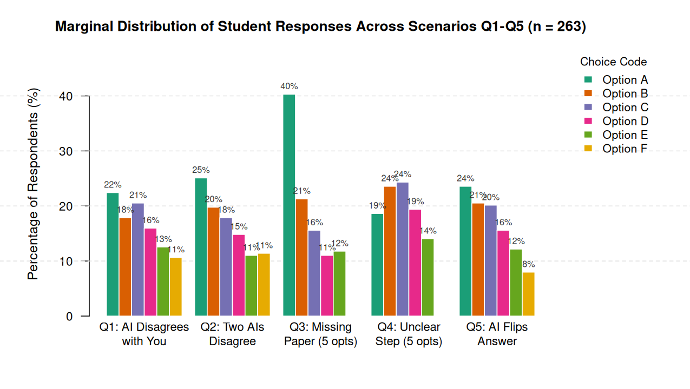

> **How to read Figure 1:** Each cluster of bars shows one question on its own (*marginal* = looking at one variable without splitting by anything else). Notice how balanced Q1, Q2, Q4, and Q5 are, whereas in **Q3**, **Option A** shoots up to **40%**—making Q3 the easiest question for two random students to match on (25.8%).

---

## 3. Clustering vocabulary

### Cluster analysis / unsupervised learning
Grouping things so that items in the same group are similar and items in different groups are different. "Unsupervised" means **nobody tells the algorithm the right answer**. It discovers the groups by itself.

### Hierarchical vs. non-hierarchical
- **Non-hierarchical (e.g. K-means)**: you say "give me K groups" up front.
- **Hierarchical**: builds a whole **family tree** of groupings, from "everyone alone" to "everyone together". You decide afterwards where to cut it.

### Agglomerative (bottom-up)
Start with 263 groups of 1 student each. At each step, **merge the two closest groups**. Repeat 262 times until one group remains. (*Divisive* does the opposite, top-down. It's rarely used because it is computationally expensive.)

> [!Note] Simple Explanation (for Presentation)
> Say you are at a party where everyone is a stranger. Initially, no one is talking to each other and is isolating themselves in different parts of the room. You take the initiative to talk to someone and find out that both of you have similar interests. Hearing your conversation, some other person joins. At the same time, another group is formed where people are talking about their interests, which may be different from your own. Slowly everyone joins in different groups that cater to their own interests. Sometimes, it may so happen, that two different topics of interests generalize to a broader topic of interest, leading to two or more groups mergeing together to form a bigger group.

### Dendrogram
The tree diagram of those merges (Figure 3 below). The **height** where two branches join is the distance at which they were merged. Low joins mean very similar students. High joins mean very different groups.

### Cutting the tree / K
Draw a horizontal line across the dendrogram. The number of branches it crosses is **K**, the number of clusters. R does this with `cutree`. We chose **K = 6**.

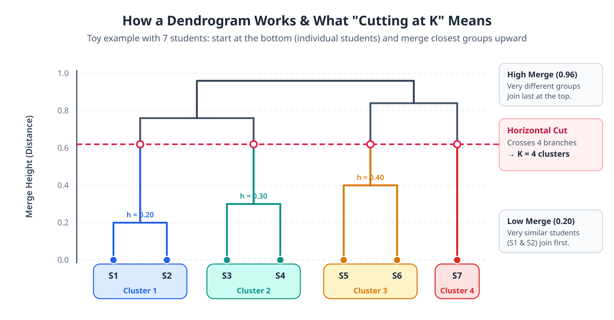

### Merge height
The distance value at which a merge happens (the y-axis of the dendrogram).

---

## 3b. Distance between students: Hamming / Gower

Clustering needs a number saying **how different two students are**. Our 5 answers (Q1–Q5) are **nominal** (A–F labels with no order), so we can't subtract them or take means. We just ask: *do the two students give the same answer or not?*

### Normalized Hamming distance
$$d_H(x,y) = \frac{1}{p}\sum_{k=1}^{p} \mathbf{1}[x_k \neq y_k], \quad p = 5$$
It is the **fraction of questions on which two students disagree**. 0 = identical answers, 1 = different on every question. Because p = 5, the only possible values are **0, 0.2, 0.4, 0.6, 0.8, 1.0**. This is the "discrete lattice" that causes ties (see section 4).

### Gower distance
Gower is a general-purpose distance for **mixed** data: for each variable it computes a 0–1 dissimilarity (numeric: scaled absolute difference; categorical: 0 if equal, 1 if not), then **averages** them. With **all-nominal** variables and no missing values, Gower **is exactly the normalized Hamming distance**, so the two names give identical numbers here. We use "Hamming" because it is the simpler name. (In R: `daisy(..., metric = "gower")` gives the same matrix.)

### Worked example
| Student | Q1 | Q2 | Q3 | Q4 | Q5 |
|---|---|---|---|---|---|
| S1 | A | B | C | A | D |
| S2 | A | B | C | A | **E** |
| S3 | A | B | **D** | A | D |
| S4 | C | E | F | B | A |

- S1 vs S2: differ only on Q5 → 1 mismatch / 5 = **0.2** (very similar)
- S2 vs S3: differ on Q3 and Q5 → 2 / 5 = **0.4**
- S1 vs S4: differ on all 5 → 5 / 5 = **1.0** (completely different)

### Distance matrix (6 example students)
Do this for every pair and you get a symmetric **distance matrix** (diagonal = 0). Here S1–S3 answer alike, S4–S6 answer alike (S5 = `CEFBB`, S6 = `DEFBA`):

|    | S1 | S2 | S3 | S4 | S5 | S6 |
|----|----|----|----|----|----|----|
| **S1** | 0 | 0.2 | 0.2 | 1.0 | 1.0 | 1.0 |
| **S2** | 0.2 | 0 | 0.4 | 1.0 | 1.0 | 1.0 |
| **S3** | 0.2 | 0.4 | 0 | 1.0 | 1.0 | 1.0 |
| **S4** | 1.0 | 1.0 | 1.0 | 0 | 0.2 | 0.2 |
| **S5** | 1.0 | 1.0 | 1.0 | 0.2 | 0 | 0.4 |
| **S6** | 1.0 | 1.0 | 1.0 | 0.2 | 0.4 | 0 |

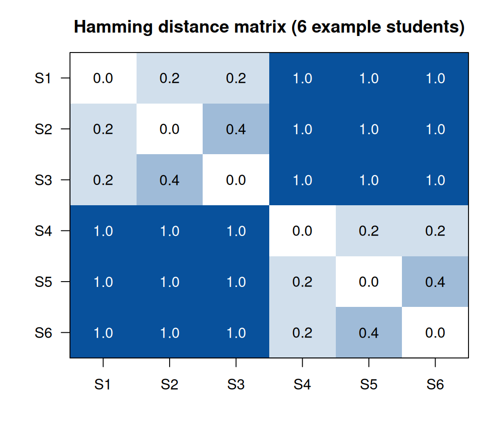

> **How to read it:** two dark blocks on the diagonal (S1–S3 and S4–S6) are the two natural clusters. Agglomerative clustering reads this matrix, merges the smallest entries first (the 0.2s), and builds the dendrogram from there. With the real data the matrix is 263 × 263, i.e. **34,453 distinct pairs** (Figure 2 in the report). The figure is generated by `output/hamming_example.R`.

### From the matrix to a dendrogram (average linkage, step by step)
Start with 6 clusters, then repeatedly merge the two closest:

| Step | Closest pair | Merge height | Why |
|---|---|---|---|
| 1 | S1 + S2 | 0.2 | smallest entry (S1–S3, S4–S5, S4–S6 also 0.2: a **tie**, broken by row order) |
| 2 | S4 + S5 | 0.2 | still the smallest entry |
| 3 | S3 joins {S1,S2} | 0.3 | average of d(S3,S1)=0.2 and d(S3,S2)=0.4 → (0.2+0.4)/2 |
| 4 | S6 joins {S4,S5} | 0.3 | average of 0.2 and 0.4 |
| 5 | {S1,S2,S3} + {S4,S5,S6} | 1.0 | all 9 cross-pairs are 1.0 → average 1.0 |

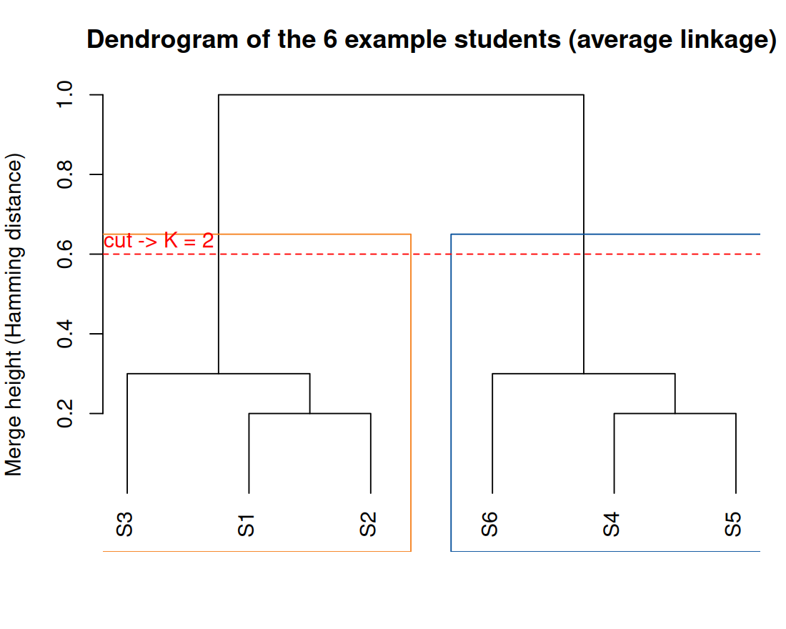

> **How to read it:** low joins (0.2–0.3) = similar students; the huge jump to 1.0 at the top means the two groups are completely different. Cutting at height ~0.6 crosses 2 branches, so **K = 2**: {S1,S2,S3} and {S4,S5,S6}. Note that step 3 already shows why average linkage creates new values (0.3) that were not on the 0.2-step grid.

---

## 4. Linkage methods: "how far apart are two *groups*?"

We know the distance between two **students**. But once students are grouped, we need a rule for the distance between two **groups**. That rule is the *linkage*.

| Linkage | Rule | Analogy | Problem in our data |
|---|---|---|---|
| **Single** (nearest neighbour) | distance of the **closest** pair across the two groups | two towns are "close" if *any* two houses are close | **Chaining**: groups get linked through a chain of in-between people, so everyone ends up in one giant blob (258 of 263 students in one cluster) |
| **Complete** (furthest neighbour) | distance of the **farthest** pair | two towns are close only if *every* house is close | the final 15 merges all happen at height 1.0 (a **tie**), so the result depends on the order of rows in the file |
| **Average (UPGMA)** | **average** of all pairwise distances between the two groups | the typical distance between towns | ✅ the averages give many distinct values (66 different heights), so ties are rare. **This is the method we used** |
| Centroid / Ward | use group **means** / variance | – | ❌ can't be used, because A–F labels have no mean |

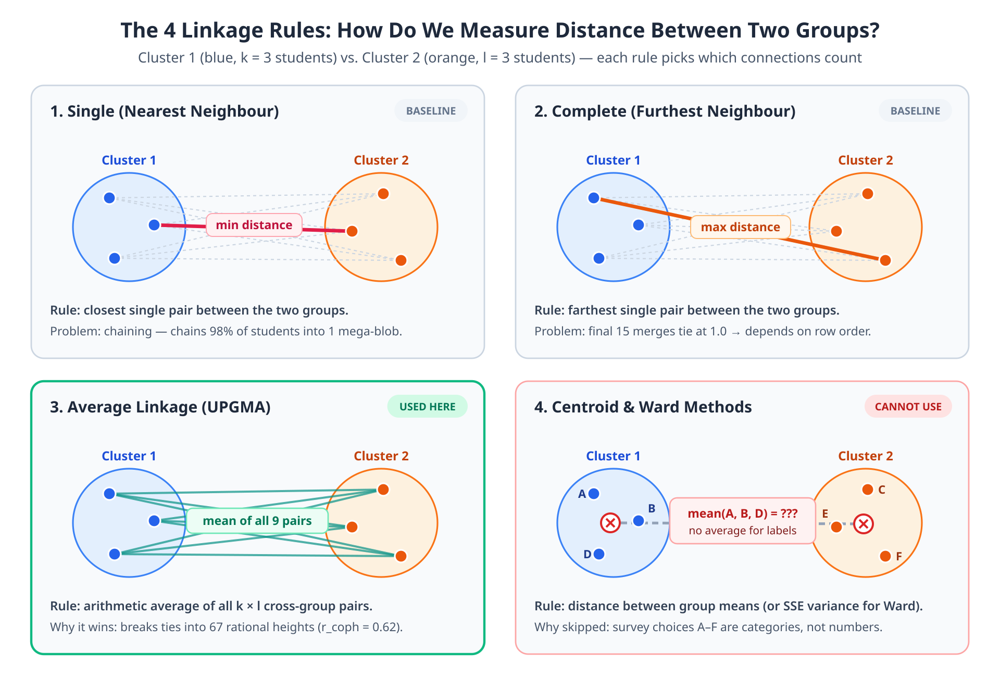

### What does UPGMA mean?
- **UPGMA** stands for **Unweighted Pair Group Mean Averaging** (another name for Average Linkage):
  - **Unweighted**: every individual student-to-student pair gets equal weight (`1 / (k × l)`), so larger clusters naturally carry more weight than tiny 1-person clusters.
  - **Pair Group**: merges two clusters (a pair of groups) at each step.
  - **Mean Averaging**: uses the arithmetic mean of all `k × l` cross-group distances.

### Why ties matter ("quantization" / "tie degeneracy")
Single and Complete linkage only take a min or max of existing distances. So **every merge height must be one of 0, 0.2, …, 1.0**. Thousands of pairs share the same height. When several merges tie, the computer picks one based on **row order in the dataset**, which is arbitrary. Average linkage divides by group sizes, so it produces values like 0.6905 or 0.7065 and ties disappear.

- **Order statistic**: the min, the max, or another ranked value from a list. Single and Complete use order statistics.
- **Rational merge heights**: fractions, produced by averaging.
- **Row order / tie-breaking**: the algorithm's arbitrary choice when several options are equally good.

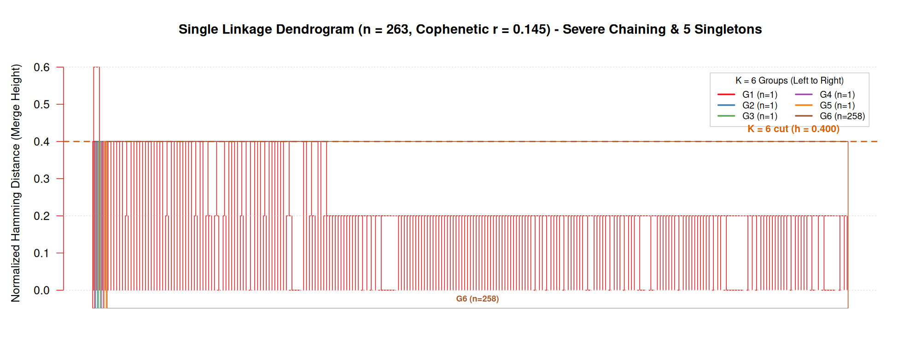

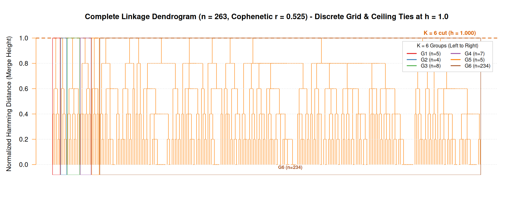

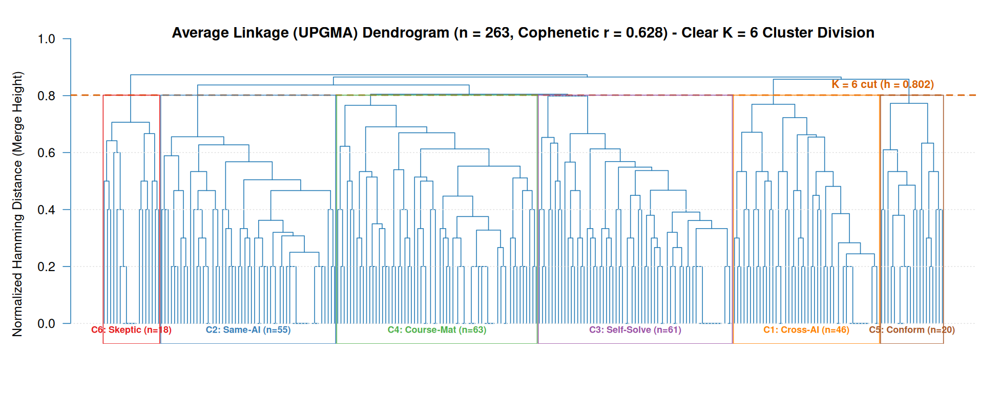

> **How to read the three full-view dendrograms (K = 6):**
> - **Single Linkage (top, red):** Almost everyone merges at `0.2` or `0.4` into one giant staircase (`n = 258` in one box) due to chaining, leaving 5 lonely singletons (`n = 1` each) on the far left.
> - **Complete Linkage (middle, orange):** Every horizontal bar snaps to the exact discrete grid `0.2, 0.4, 0.6, 0.8, 1.0`, and the top 15 merges pile up in a flat ceiling at `1.0` — producing one huge `n = 234` group and five tiny fragments (`n = 4` to `8`).
> - **Average / UPGMA (bottom, blue):** Smooth, varied merge heights (`0.6905`, `0.7065`, ...) eliminate tie degeneracy and divide the 263 students into **6 balanced, clearly separated clusters** (`C1`–`C6`, `n = 18` to `63`).

---

## 5. How good is the tree? Cophenetic correlation

- **Cophenetic distance** between two students: the dendrogram height where they first end up in the same branch.
- **Cophenetic correlation** $r_{coph}$: the **correlation** between the real distances and the tree's cophenetic distances. It answers: "Does the tree faithfully represent the original distances?"
- **Correlation** in general: a number from −1 to 1 measuring how strongly two quantities move together. 1 means perfect agreement and 0 means no relation.

| Method | r_coph | Interpretation |
|---|---|---|
| Average | **0.63** | best: reasonably faithful (see Figure 3 right) |
| Complete | 0.53 | OK (see Figure 3 middle) |
| Single | 0.14 | poor: the tree distorts the real distances (see Figure 3 left) |

### How $r_{coph}$ is calculated for the whole dataset
With $n = 263$ students, there are $M = \binom{263}{2} = \frac{263 \times 262}{2} = 34{,}453$ unique pairs of students:

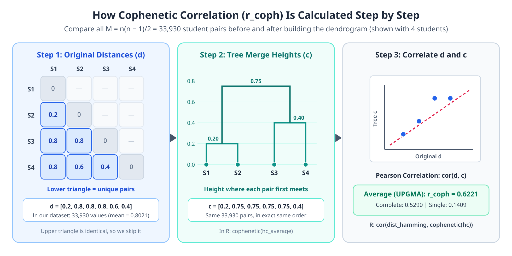

1. **Original distance vector ($d$):** Take the **lower triangle** of the $263 \times 263$ Hamming distance matrix (skipping the `0` diagonal and duplicate upper triangle) and flatten it into one list of $34{,}453$ distances:
   $$d = (d_{1,2},\; d_{1,3},\; \dots,\; d_{262,263})$$
2. **Tree distance vector ($c$):** For each of those exact same $34{,}453$ pairs $(i, j)$, read the **merge height** from the dendrogram where student $i$ and student $j$ first join the same branch:
   $$c = (c_{1,2},\; c_{1,3},\; \dots,\; c_{262,263})$$
3. **Pearson correlation between $d$ and $c$:**
   $$r_{\text{coph}} = \frac{\sum_{m=1}^{M} (d_m - \bar{d})(c_m - \bar{c})}{\sqrt{\sum_{m=1}^{M} (d_m - \bar{d})^2} \cdot \sqrt{\sum_{m=1}^{M} (c_m - \bar{c})^2}}$$
   where $\bar{d} = 0.8016$ is the mean original Hamming distance and $\bar{c}$ is the mean tree merge height.

> **Tiny 3-student example:** Suppose 3 students (`A`, `B`, `C`) have original distances $d = (d_{AB}=0.2,\; d_{AC}=0.8,\; d_{BC}=0.8)$. If `A` and `B` merge at `0.2` and then join `C` at `0.8`, the tree distances are $c = (0.2, 0.8, 0.8)$ $\rightarrow$ correlation = **$1.0$** (perfect). If Single Linkage chains `C` in early at `0.4`, $c = (0.2, 0.4, 0.4)$, shrinking the `0.8` gap and lowering $r_{\text{coph}}$.

In [analysis.R](code/analysis.R#L171-L173), R computes all three steps in one line:
```r
coph_average <- cor(dist_hamming, cophenetic(hc_average))
```

---

## 6. How many clusters? Silhouette width

For each student *i*:
- **a(i)** = average distance to the students in **their own** cluster (how well they fit at home)
- **b(i)** = average distance to the students in the **nearest other** cluster (how close the neighbours are)

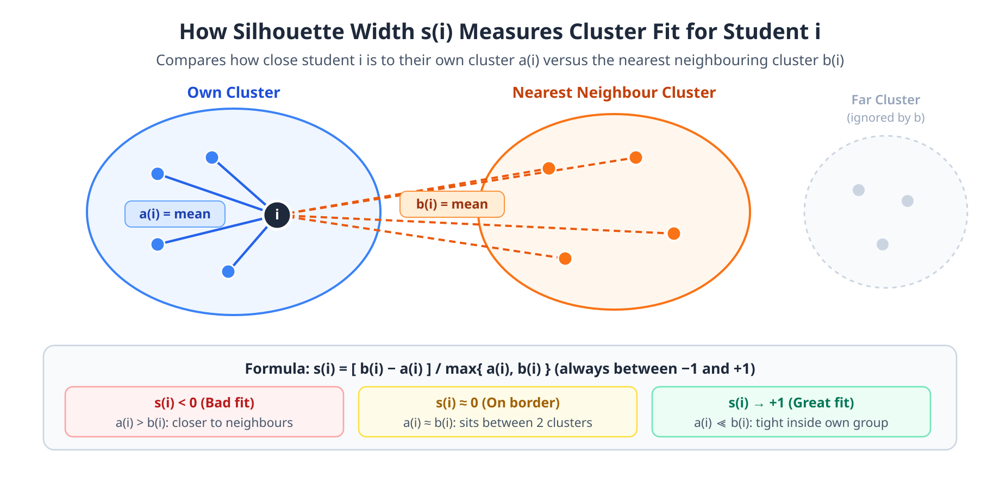

$$
s(i) = \frac{b(i) - a(i)}{\max\{a(i),\, b(i)\}}
$$

| s(i) value | Meaning |
|---|---|
| close to +1 | clearly in the right cluster |
| around 0 | on the border between two clusters |
| negative | probably in the wrong cluster |

- **Average silhouette width** $\bar s$: the mean of s(i) over all students. **Higher is better.** We tried K = 2…8 and chose the K with the highest value: **K = 6, s̄ = 0.200**.
- **Negative silhouette %**: share of students who seem misplaced. At K = 6 it is lowest (15.6%).
- **Max cluster %**: size of the biggest cluster. A huge value (98%) signals chaining. At K = 6 it is 24.0%, which is balanced.

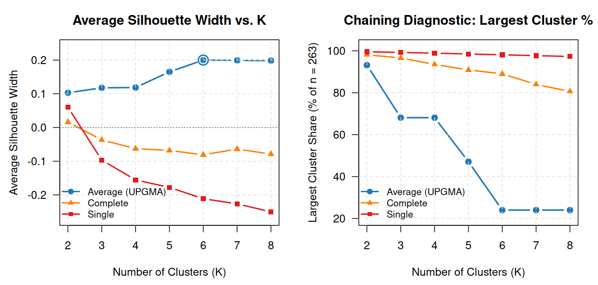

> **How to read Figure 4:**
> - **Left:** The blue Average (UPGMA) line climbs steadily and **peaks at the circled point K = 6** (`0.200`). Single (red) and Complete (orange) drop below `0`, meaning many students sit closer to a neighbouring cluster than to their own.
> - **Right:** Under Single linkage, one mega-cluster holds ~98% of all 263 students regardless of `K`. Under Average linkage, the largest cluster drops sharply from `93%` (`K = 2`) down to a healthy **`24.0%` at `K = 6`**.

> Is 0.200 low? Yes, by textbook standards (above 0.5 counts as "strong"). But survey answers from humans are noisy and only 5 questions are available, so weak-but-real structure is expected. That's why the stability checks and external validation below matter.

---

## 7. Are the clusters stable? Adjusted Rand Index (ARI)

### Rand Index / ARI
A score for **how similar two groupings of the same people are**. It looks at every pair of students and asks: "Are these two together in both groupings, or apart in both?"
- **Adjusted** means it is corrected for agreement that would happen by pure chance.
- ARI = 1: identical groupings. ARI ≈ 0: no better than random. Negative: worse than random.
- Rough guide: above 0.5 is moderate–good, below 0.2 is poor.

### Worked example (6 students)
Suppose we cluster 6 students (`S1`–`S6`) twice, and only **`S3`** switches groups:
- **Grouping A:** `{S1, S2, S3}` and `{S4, S5, S6}`
- **Grouping B:** `{S1, S2}` and `{S3, S4, S5, S6}`

With $n = 6$ students, there are $\binom{6}{2} = 15$ pairs. We check each pair:
- **$a = 4$** pairs are **together in both** (`S1–S2`, `S4–S5`, `S4–S6`, `S5–S6`) ✓
- **$b = 6$** pairs are **apart in both** (`S1–S4`, `S1–S5`, `S1–S6`, `S2–S4`, `S2–S5`, `S2–S6`) ✓
- **$5$** pairs **disagree** (`S1–S3`, `S2–S3` split; `S3–S4`, `S3–S5`, `S3–S6` joined) ✗

1. **Raw Rand Index (RI):** fraction of agreeing pairs = $\frac{4 + 6}{15} = \mathbf{0.67}$. This looks high, *even though random groupings also agree on many pairs by chance*.
2. **Adjusted Rand Index (ARI):** subtracts the expected chance agreement ($\text{Expected} = 2.80$, $\text{Max} = 6.50$):
   $$\text{ARI} = \frac{\text{Index} - \text{Expected}}{\text{Max} - \text{Expected}} = \frac{4 - 2.80}{6.50 - 2.80} = \mathbf{0.32}$$

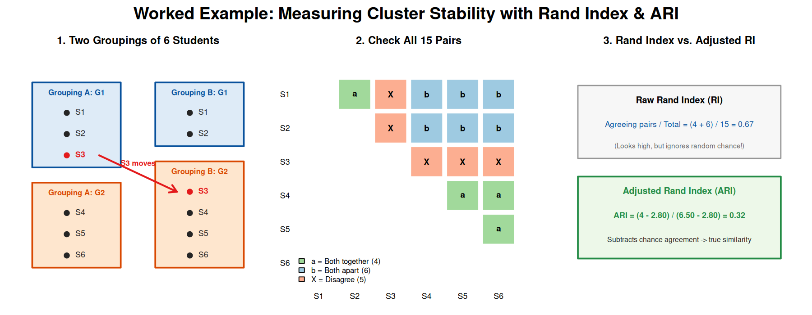

> **Why ARI is better than RI:** RI gives `0.67` because separating `S1–S2` from `S4–S6` is easy, inflating the score. ARI removes that baseline luck and drops to `0.32`, fairly reflecting that 1 out of 6 students moved. (Generated by `output/ari_example.R`.)

### Two stability experiments
1. **Row-order permutation (100 shuffles)**: shuffle the order of students in the file, re-cluster, and compare with the original using ARI. This tests the tie-breaking problem from §4.
   Complete: 0.137 (collapses). Average K = 6: **0.51**.
2. **80% subsampling (100 times)**: randomly keep 210 of 263 students (**without replacement** = nobody is picked twice), re-cluster, and compare. This tests whether the groups depend on a few particular people.
   Average K = 6: **ARI ≈ 0.52** (moderate stability).

`± value` here is again the SD across the 100 repetitions.

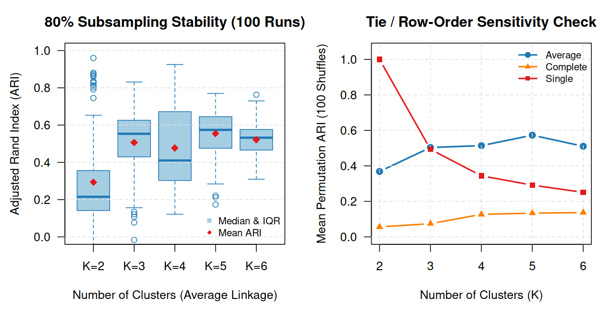

> **How to read Figure 5:**
> - **Left (Boxplots for Average linkage):** Each blue box covers the middle 50% of the 100 runs (**IQR**), the thick horizontal line is the **median**, the red diamond is the **mean**, dashed whiskers show typical min/max, and open circles are **outliers**. `K = 5` and `K = 6` hold steady around `0.52–0.56` (well above `K = 2`).
> - **Right (Line chart):** Shuffling the row order makes **Complete linkage (orange)** collapse near `0.07–0.14` because of its tied ceiling merges at `1.0`, while **Average linkage (blue)** stays around `0.51–0.57`.

---

## 8. Do the clusters mean something outside the data? External validation

The clusters were built from Q1–Q5 only, so of course they differ on Q1–Q5. That's circular. The real test is whether they also differ on variables the algorithm **never saw**: **Q6** (AI days/week) and **S4** (year of study).

| External variable | Data type | Tests used |
|---|---|---|
| **Q6** (AI days/week, `0–7`) | Numeric count | **One-way ANOVA** + **Kruskal–Wallis H test** |
| **S4** (Year of study, `1st Yr`–`Grad`) | Categorical | **Pearson's Chi-square ($\chi^2$)** with Monte Carlo simulation |

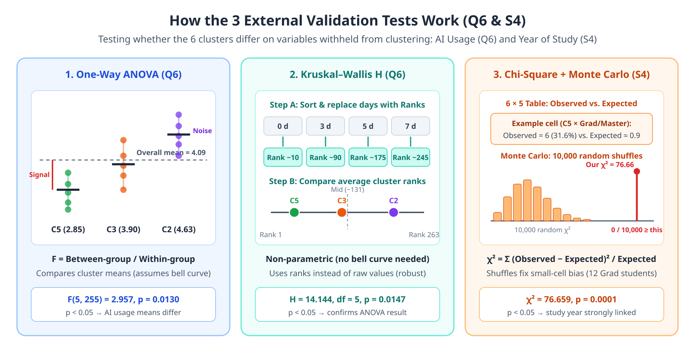

### Hypothesis test, p-value, significance
- **Null hypothesis (H₀)**: "there is no difference between clusters" (e.g. all clusters use AI equally often, or have the same mix of study years).
- **p-value**: *if H₀ were true*, how likely it would be to see differences at least this large purely by chance.
- Convention: **p < 0.05 counts as "statistically significant"**, meaning we reject H₀ and conclude the difference is probably real.
- A p-value says *whether* a difference exists. It does **not** say how big or important the difference is.

---

### Method 1: One-way ANOVA (for Q6)
Compares the **means** of a numeric variable across 3 or more groups. Think of it as a **signal-to-noise ratio**:

1. **Signal (variation *between* groups):** How far each cluster's mean (e.g. `2.85` for C5 vs. `4.67` for C2) sits from the overall mean (`4.10` days/week).
2. **Noise (variation *within* groups):** How spread out individual students are inside their own cluster.
3. **F statistic:**
   $$F = \frac{\text{variation between cluster means}}{\text{variation within clusters}}$$
   A large `F` means the gap between clusters stands out clearly above normal student-to-student variation.
4. **Degrees of freedom `F(5, 257)`:** `5 = 6 clusters − 1` (between-group df) and `257 = 263 students − 6 clusters` (within-group df).
5. **Result:** $F = 3.148$, **$p = 0.0089 < 0.05$** $\rightarrow$ average weekly AI usage genuinely differs across the 6 clusters.

> **Why we don't stop at ANOVA:** ANOVA assumes data inside each group roughly follows a bell curve (normal distribution). Because `Q6` is a bounded integer count (`0` to `7` days), we double-check with the non-parametric test below.

---

### Method 2: Kruskal–Wallis H test (for Q6)
The **non-parametric** (distribution-free) cousin of ANOVA. Instead of using the raw day counts (`0..7`), it works on **ranks**:

1. Sort all 263 students from lowest AI usage (`0` days) to highest (`7` days) and assign each student a **rank** from `1` to `263` (tied values share the average rank).
2. Compute the average rank inside each of the 6 clusters.
3. Under $H_0$ ("no difference"), every cluster's average rank should sit near the middle (`~132`). The further the clusters pull apart in rank (e.g. C5 near the bottom, C2 near the top), the larger the **$H$ statistic** becomes.
4. **Result:** $H = 15.023$, `df = 5` (`6 clusters − 1`), **$p = 0.0103 < 0.05$**. Because both ANOVA ($p = 0.009$) and Kruskal–Wallis ($p = 0.010$) agree, the finding is robust.

---

### Method 3: Pearson's Chi-Square ($\chi^2$) Test + Monte Carlo Simulation (for S4)
Used when **both** variables are categories (6 clusters × 5 study years: `1st Yr`, `2nd Yr`, `3rd Yr`, `4th Yr`, `Grad/Master`). You cannot take a mean of "2nd Year" and "Master's", so we compare **counts**:

1. **Build a 6 × 5 contingency table** of the **observed** student counts (`n = 257` with known study year).
2. **Compute expected counts** assuming $H_0$ ("cluster and study year are completely unrelated"):
   $$\text{Expected}(r, c) = \frac{(\text{row } r \text{ total}) \times (\text{column } c \text{ total})}{n}$$
3. **Measure total mismatch ($\chi^2$):**
   $$\chi^2 = \sum \frac{(\text{Observed} - \text{Expected})^2}{\text{Expected}} = 77.045$$
   If observed counts match expected counts closely, $\chi^2 \approx 0$. A big $\chi^2$ means the table is far from "unrelated".
4. **Why Monte Carlo simulation (10,000 replicates)?** The textbook $\chi^2$ formula becomes inaccurate when some table cells have small expected counts (we only have 12 Grad/Master's students spread across 6 clusters). To be safe, the computer randomly shuffles the `S4` labels **10,000 times** (simulating "no relationship"), recalculates $\chi^2$ each time, and checks how often a random table reaches $\ge 77.045$. **None of the 10,000 random tables did**, giving **$p = 0.0001$** (the smallest possible value with 10,000 runs).
5. **Row %:** Percentages computed across each cluster's row (each cluster adds up to 100%, as shown in Figure 7 right).

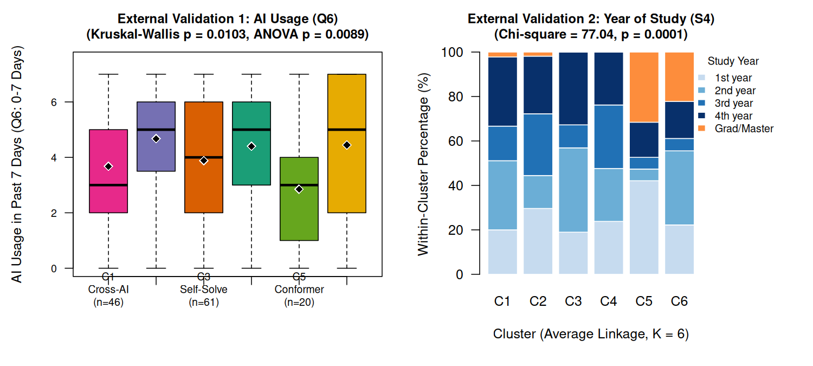

> **How to read Figure 7:**
> - **Left (Q6, boxplots for C1–C6 left to right):** Thick black bars mark the **medians** and black diamonds mark the **means**. **C5 (AI Conformers, green)** uses AI the least (`mean 2.85`, `median 3.0` days/week), while **C2 (Same-AI Probe, purple)** uses it the most (`mean 4.67`, `median 5.0` days/week).
> - **Right (S4, 100% stacked bars):** Each bar adds to 100% within a cluster (Row %). Notice the tall orange **Grad/Master** block and tall light-blue **1st-year** block in **C5**, whereas **C3** and **C4** are 100% undergraduates.

---

## 9. Other terms you might trip over

| Term | Meaning |
|---|---|
| **Metric axioms** (symmetry, positivity, identity, triangle inequality) | rules a "proper" distance must follow: A→B equals B→A; the distance is never negative; it is 0 for identical items; a detour can't be shorter than the direct route. Hamming satisfies all four |
| **Profile** | one student's 5 answers, e.g. `B-B-A-B-B` |
| **Archetype** | a named cluster, i.e. a typical behaviour pattern |
| **Within-cluster %** | inside one cluster, the % choosing each option (Table 2 / Figure 6) |
| **Singleton** | a cluster containing just 1 person |
| **Partition** | one way of dividing everyone into non-overlapping groups |
| **Binomial coefficient** $\binom{263}{2}$ | number of possible pairs = 263 × 262 / 2 = 34,453 |
| **SSE / SST / R²** (Ward section) | error / total sum of squares. R² = share of the variation explained by the grouping. Mentioned only to explain why Ward can't be used |
| **One-hot / dummy coding** | turning A–F into six 0/1 columns. An alternative we deliberately avoided |

---

## 10. The whole study in one view

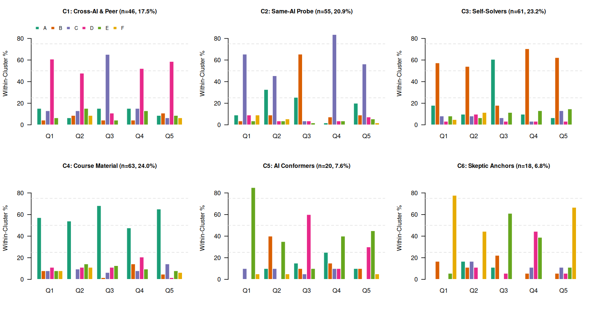

> **How to read Figure 6:** Each panel is one cluster (`C1`–`C6`). A tall spike in the same colour across Q1–Q5 reveals that group's signature habit—for example, **pink/D** in `C1` (ask another AI/classmate), **purple/C** in `C2` (ask the same AI), **orange/B** in `C3` (solve yourself), and **teal/A** in `C4` (check course materials).

| Step | Tool | Result |
|---|---|---|
| Measure student differences | Normalized Hamming (Gower) | mean distance 0.80 (students are quite diverse) |
| Build groups | Average linkage (UPGMA) hierarchical clustering | 66 distinct merge heights, no tie problem |
| Check the tree | Cophenetic correlation | 0.63 (best of the 3 linkages) |
| Choose K | Average silhouette width | K = 6, s̄ = 0.200 |
| Check stability | ARI (shuffle and subsample) | ≈ 0.51–0.52, moderately stable |
| Check external meaning | ANOVA, Kruskal–Wallis, χ² | p = 0.009, 0.010, 0.0001 → all significant |
| Interpret | Within-cluster % | 6 archetypes (Course-Material Verifiers 24%, Independent Solvers 23%, Same-AI 21%, Cross-AI/Peer 17%, Uncritical Conformers 8%, Skeptical Anchors 7%) |

